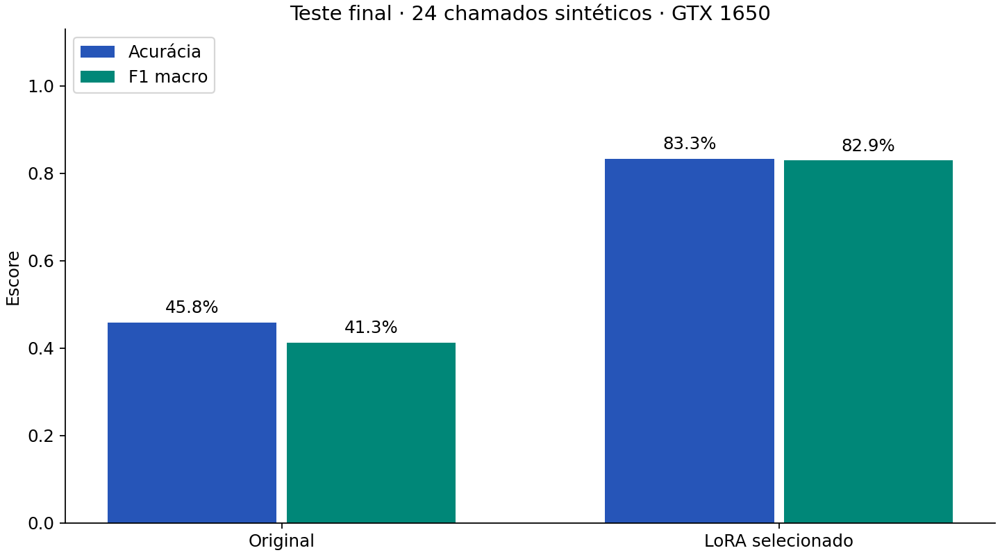
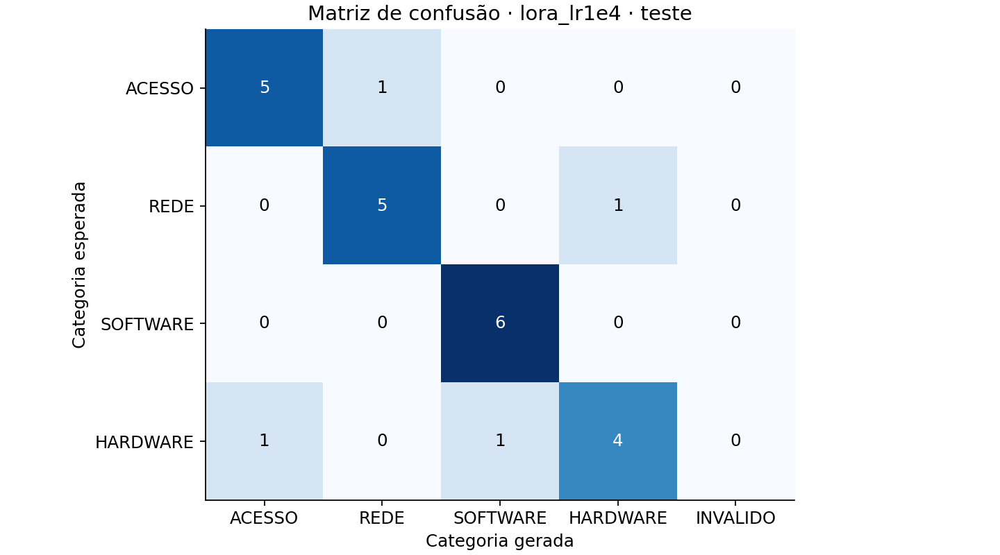
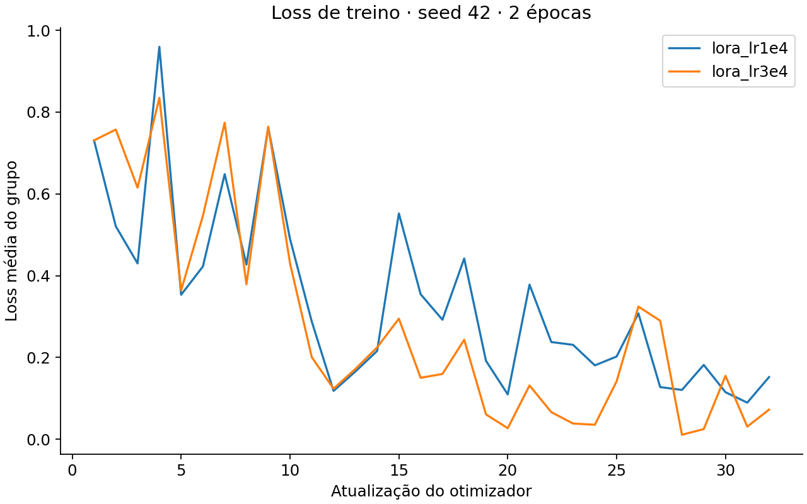
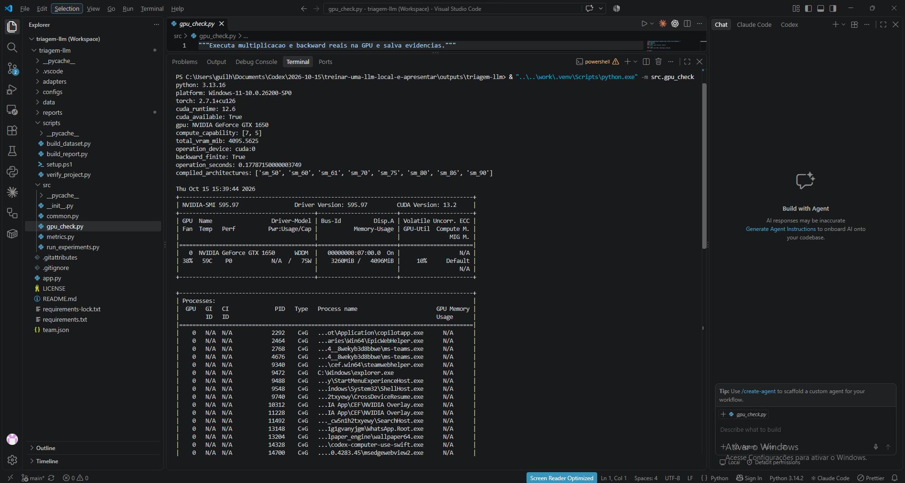
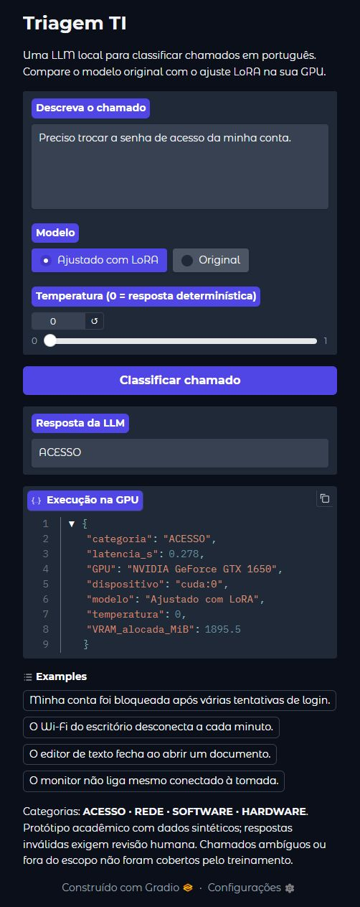

# Resultados reais — Triagem TI

**Integrantes:** Guilherme Rezende (RM 98508); Matheus Brisqui (RM 97892); Gustavo Brisqui (RM 97969).

Entrega em trio autorizada pelo professor, conforme informado pelo grupo.

Execução local na **NVIDIA GeForce GTX 1650**, PyTorch **2.7.1+cu126**, runtime CUDA **12.6**. Operações e backward confirmados em `cuda:0`. Os números abaixo são lidos dos JSONs desta entrega, sem valores simulados.

## Seleção pela validação (16 exemplos)

| Modelo | Acurácia | F1 macro | Treino (s) | Pico alocado (MiB) |
| --- | --- | --- | --- | --- |
| Original | 62.50% | 0.5652 | — | — |
| lora_lr1e4 | 87.50% | 0.8730 | 31.98 | 2130.6 |
| lora_lr3e4 | 81.25% | 0.7818 | 30.56 | 2130.3 |

Selecionado: **lora_lr1e4**, pela validação. A taxa de aprendizado maior não deve ser escolhida só por reduzir a loss de treino: observe as confusões por classe.

Tempos de treinamento são observações de uma execução sequencial, sem aquecimento controlado. A diferença de tempo não demonstra que uma taxa de aprendizado é mais rápida. O pico alocado pelo PyTorch não inclui toda a VRAM usada pelo Windows e outros aplicativos.

## Teste final intocado (24 exemplos, 6 por classe)

| Modelo | Acertos | Acurácia | F1 macro | Formato válido | Latência média (s) |
| --- | --- | --- | --- | --- | --- |
| baseline | 11/24 | 45.83% | 0.4128 | 100.00% | 0.137 |
| lora_lr1e4 | 20/24 | 83.33% | 0.8293 | 100.00% | 0.174 |

Variação de acurácia neste conjunto: **+37.50 pontos percentuais**. F1 macro: **0.4128 → 0.8293**. Não foi feito teste de significância estatística.

## Métricas por classe do ajuste escolhido

| Classe | Precisão | Recall | F1 | Suporte |
| --- | --- | --- | --- | --- |
| ACESSO | 0.8333 | 0.8333 | 0.8333 | 6 |
| REDE | 0.8333 | 0.8333 | 0.8333 | 6 |
| SOFTWARE | 0.8571 | 1.0000 | 0.9231 | 6 |
| HARDWARE | 0.8000 | 0.6667 | 0.7273 | 6 |

## Respostas do teste: antes e depois

| Chamado | Esperado | Original | LoRA | Acertou após ajuste? |
| --- | --- | --- | --- | --- |
| Nao lembro mais a credencial usada para entrar no RH. | ACESSO | HARDWARE | ACESSO | sim |
| Um colega novo precisa de um usuario no sistema. | ACESSO | SOFTWARE | ACESSO | sim |
| Meu perfil permite visualizar, mas preciso de autorizacao para alterar dados. | ACESSO | SOFTWARE | ACESSO | sim |
| Perdi o dispositivo que gera os codigos de login. | ACESSO | SOFTWARE | REDE | não |
| O portal recusa a entrada porque a conta venceu. | ACESSO | HARDWARE | ACESSO | sim |
| Solicito revogar as permissoes de uma conta antiga. | ACESSO | ACESSO | ACESSO | sim |
| Toda a equipe ficou sem acesso a sites ao mesmo tempo. | REDE | SOFTWARE | HARDWARE | não |
| O notebook se conecta ao ponto sem fio mas fica sem internet. | REDE | SOFTWARE | REDE | sim |
| A ligacao com a rede da matriz cai de tempos em tempos. | REDE | REDE | REDE | sim |
| Ha muita perda de pacotes entre os dois predios. | REDE | SOFTWARE | REDE | sim |
| Nenhuma maquina recebe IP automaticamente nesta sub-rede. | REDE | SOFTWARE | REDE | sim |
| O sinal wireless nao chega na recepcao. | REDE | SOFTWARE | REDE | sim |
| O aplicativo de contabilidade encerra quando gero o balanco. | SOFTWARE | SOFTWARE | SOFTWARE | sim |
| A atualizacao do programa de edicao retorna um erro. | SOFTWARE | HARDWARE | SOFTWARE | sim |
| Ao clicar em salvar no editor, o documento desaparece e o aplicativo trava. | SOFTWARE | SOFTWARE | SOFTWARE | sim |
| O visualizador de imagens apresenta uma excecao ao carregar fotos. | SOFTWARE | SOFTWARE | SOFTWARE | sim |
| Preciso instalar o utilitario de compactacao de arquivos. | SOFTWARE | SOFTWARE | SOFTWARE | sim |
| A ferramenta de calendario abre mas fica sem responder. | SOFTWARE | SOFTWARE | SOFTWARE | sim |
| A tecla de espaco se desprendeu do teclado. | HARDWARE | HARDWARE | HARDWARE | sim |
| O visor sofreu uma trinca e ficou com manchas. | HARDWARE | HARDWARE | HARDWARE | sim |
| A ventoinha nao gira e o gabinete esquenta muito. | HARDWARE | HARDWARE | HARDWARE | sim |
| O conector do carregador quebrou dentro do equipamento. | HARDWARE | HARDWARE | HARDWARE | sim |
| O botao esquerdo do mouse afundou e nao retorna. | HARDWARE | ACESSO | ACESSO | não |
| O mecanismo da impressora nao puxa as folhas da bandeja. | HARDWARE | SOFTWARE | SOFTWARE | não |

## Erros que permanecem

- test_acesso_04: “Perdi o dispositivo que gera os codigos de login.” — esperado **ACESSO**, gerado **REDE**.

- test_rede_01: “Toda a equipe ficou sem acesso a sites ao mesmo tempo.” — esperado **REDE**, gerado **HARDWARE**.

- test_hardware_05: “O botao esquerdo do mouse afundou e nao retorna.” — esperado **HARDWARE**, gerado **ACESSO**.

- test_hardware_06: “O mecanismo da impressora nao puxa as folhas da bandeja.” — esperado **HARDWARE**, gerado **SOFTWARE**.

As saídas brutas, IDs, dispositivo e latência de cada exemplo estão nos JSONs; não houve correção manual das respostas.

## Treinamento e recursos

- Parâmetros treináveis: **540,672**, de **494,573,440** incluindo LoRA (**0.109%**).

- Atualizações do otimizador por experimento: **32**. Dispositivo **cuda:0**, precisão **torch.float32**.

- A loss supervisiona somente tokens da resposta e do encerramento da conversa. Os prompts são mascarados com -100.

## Evidências visuais

## Limitações e conclusão

O ajuste melhorou as métricas observadas neste teste sintético pequeno. Isso não estabelece desempenho em chamados reais. Uma seed, frases curtas e classes balanceadas não permitem estimar a robustez em produção. Categorias ambíguas, múltiplos problemas, dados fora do escopo e ataques por prompt não foram avaliados sistematicamente. A loss menor do segundo ajuste não garantiu melhor F1 de validação.

A latência mede geração sincronizada com CUDA, sem warmup separado; o primeiro exemplo pode incluir inicialização. Não inclui download, carregamento dos pesos nem tempo de transporte do frontend. O adaptador adiciona operações ao modelo, e a comparação de velocidade exige repetições controladas.

Para uma extensão do trabalho: coletar chamados autorizados e anonimizados, separar por tempo/origem, usar dupla rotulagem, ampliar exemplos por classe, treinar com três ou mais seeds e reservar um novo teste antes de explorar outras configurações.
